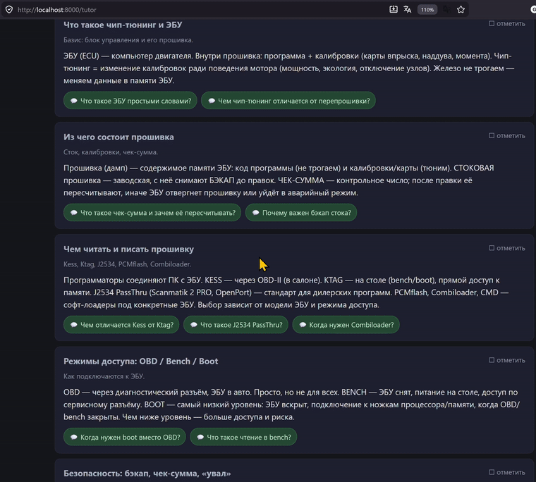
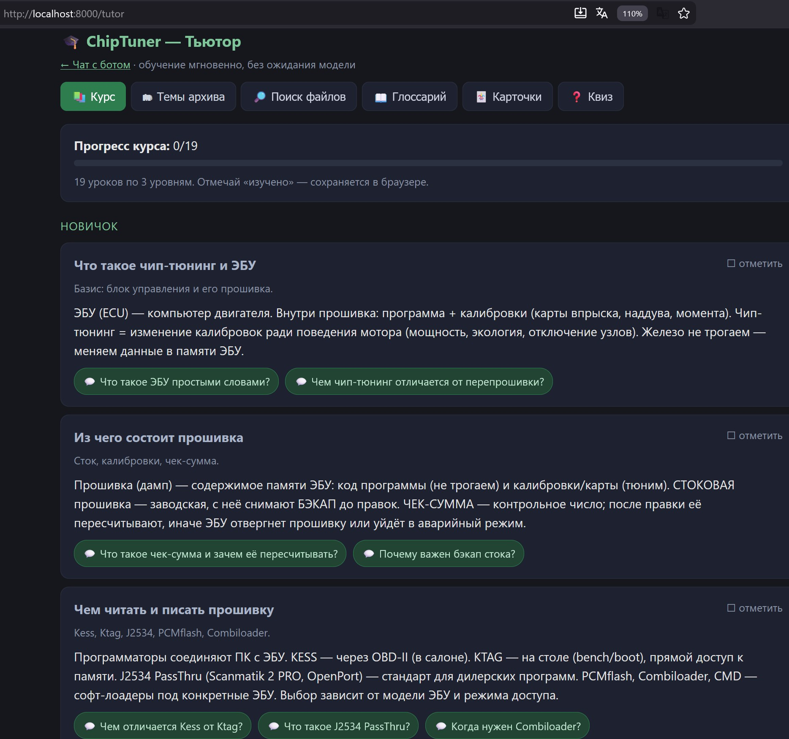

# ChipTuner Assistant

Локальный (офлайн) ИИ-ассистент по технической документации — на примере справочников
и мануалов чип-тюнинга. Отвечает на вопросы по твоим PDF/DOC/TXT, используя локальную
модель в **LM Studio** + поиск по документам (**RAG**), и даёт обучающий режим для
новичков. **Ничего не уходит в интернет** — модель, эмбеддинги и индекс работают локально.



## Что умеет

- 💬 **Чат с ботом** по твоим документам (RAG): вопрос → релевантные фрагменты → ответ
  локальной модели, со ссылками на файлы-источники (клик открывает файл).
- 🎓 **Тьютор для новичка** — отдельная вкладка, всё мгновенно (без ожидания модели):
  курс по уровням, глоссарий терминов, флеш-карточки, квиз, темы из каталога файлов.
- 🗂 **Каталог файлов** — быстрый полнотекстовый поиск (SQLite FTS5) по тысячам файлов
  с эвристиками бренда/типа.
- ⚙️ **Авто-оптимизация под железо и модель** — программа сама подбирает оптимальные
  параметры LLM (выключение «размышлений», max_tokens, бюджет контекста) под фактически
  загруженную в LM Studio модель и под твоё железо (CUDA / без CUDA).
- 🖥️ **Web-UI** с рендером Markdown и потоковым ответом, либо консольный чат.



## Как устроено

```
твои документы (pdf/doc/txt)
        │
   src/ingest.py   : текст → чанки → embeddings (multilingual-e5, CPU) → ChromaDB
        │
   src/rag.py      : вопрос → top-k фрагментов (+ файлы каталога) → LLM → ответ
        │
   src/web.py      : браузер (стрим, источники, тьютор)  /  src/chat.py : консоль
        │
   src/optimize.py : авто-настройка LLM под железо и загруженную модель
```

«Дообучение» = добавляешь новые файлы и запускаешь `ingest` заново (RAG читает свежий
индекс при каждом вопросе). Веса модели не меняются — LM Studio так не умеет.

## Требования

- **Python 3.11+** (разрабатывалось на 3.14).
- **LM Studio** (https://lmstudio.ai) с включённым локальным сервером
  (вкладка *Developer → Start Server*, порт 1234) и загруженной chat-моделью.
- ~2–4 ГБ под модель эмбеддингов и индекс. GPU не обязателен (всё умеет на CPU; на GPU
  без CUDA, напр. Intel Arc, LLM идёт через Vulkan в LM Studio).
- (опционально) **7-Zip** — если используешь скрипты распаковки защищённых .7z.

## Установка

```bash
git clone https://github.com/<owner>/<repo>.git
cd <repo>
python -m venv .venv
# Windows:
.venv\Scripts\activate
# Linux/macOS:
source .venv/bin/activate

pip install -r requirements.txt
```

## Настройка

Всё в `config.yaml`:

| Ключ | Что задаёт |
|------|------------|
| `docs_dirs` | список папок с документами (pdf/doc/txt), по которым строится поиск |
| `data_dir` | куда складывать индекс (ChromaDB) и кэш |
| `embedding_model` | модель эмбеддингов (по умолчанию `intfloat/multilingual-e5-small`, хорошо для русского) |
| `chunk_chars` / `chunk_overlap` | размер и перекрытие чанков |
| `lmstudio.base_url` | адрес LM Studio (`http://localhost:1234/v1`) |
| `lmstudio.model` | id chat-модели (если не загружена — берётся любая загруженная) |
| `top_k`, `max_context_chars`, `max_tokens` | подбираются авто-оптимизатором под железо/модель |
| `archive_password`, `archive_zip` | только для скриптов распаковки .7z (опционально) |

> Пароли в коде не хранятся. Для скриптов распаковки пароль задаётся в `config.yaml`
> (`archive_password`) или через переменную окружения `CHIPTUNER_ARCHIVE_PW`.

## Запуск

### 1. LM Studio
Открой LM Studio → загрузи chat-модель → вкладка **Developer → Start Server** (порт 1234).

> На слабом/без-CUDA железе бери лёгкую быструю модель (напр. `liquid/lfm2.5-1.2b`).
> Авто-оптимизатор сам подстроит параметры под загруженную модель — менять config не нужно.

### 2. Индексация документов
```bash
python -m src.ingest          # построить индекс по docs_dirs
python -m src.ingest --reset  # очистить и заново
```

### 3. Интерфейс
Web-UI (основной):
```bash
python -m src.web
```
→ открой **http://localhost:8000** — чат, и ссылка на **/tutor** (тьютор для новичка).

Либо консольный чат:
```bash
python -m src.chat
```
Команды в чате: `/files` — файлы по теме, `/src` — источники, `/quit` — выход.

## Использование

- **Чат:** задай вопрос — бот найдёт фрагменты, ответит и покажет источники
  (клик по источнику открывает файл локально). Markdown в ответе рендерится.
- **Тьютор** (`/tutor`): вкладки **Курс / Темы архива / Поиск файлов / Глоссарий /
  Карточки / Квиз**. Кнопки уроков «спросить бота» открывают чат с готовым вопросом.
- **Поиск по каталогу** (без LLM, мгновенно):
  ```bash
  python -m src.cat_search "EDC17"
  python -m src.cat_search --brand "Mercedes-Benz" --ext pdf
  python -m src.cat_search --stats
  ```

## Авто-оптимизация (важно)

При старте и в фоне (раз в ~15 с) `src/optimize.py` проверяет железо (`src/hardware.py`:
CPU/RAM/GPU, наличие CUDA) и **реально загруженную** в LM Studio модель (её контекст,
квант, арх), затем сам выставляет:

- **reasoning = off** у reasoning-моделей (gemma-4, QwQ, R1) — без скрытых размышлений;
- **max_tokens** и **бюджет контекста** под фактический `n_ctx` (промпт не переполнит окно);
- **top_k** под доступный контекст;
- на **не-CUDA** железе (Intel Arc / AMD / CPU) prefill промпта медленный, поэтому
  контекст держится компактным ради быстрого первого токена; на **CUDA** — наоборот,
  контекст набивается для полноты.

Сменил модель в LM Studio — ничего делать не надо, параметры пересчитаются сами.

## Обслуживание

```bash
python -m src.doctor      # проверка окружения (LM Studio, индекс, модель эмбеддингов)
python -m src.ingest      # переиндексировать (уже проиндексированное пропускается)
```

## Структура

```
src/
  ingest.py      индексация документов → ChromaDB
  rag.py         retrieval + сборка ответа
  embed.py       эмбеддинги (sentence-transformers, e5)
  lmstudio.py    клиент LM Studio (OpenAI-совместимый API)
  optimize.py    авто-оптимизация LLM под железо/модель
  hardware.py    детект CPU/RAM/GPU
  web.py         FastAPI + SSE web-UI (чат)
  tutor.py       вкладка «Тьютор» (курс, глоссарий, карточки, квиз)
  tutor_data.py  учебные данные (уроки, термины)
  glossary.py    сборка глоссария из документов
  catalog.py     каталог файлов в SQLite (FTS5)
  cat_search.py  поиск по каталогу
  classify.py    эвристики бренд/тип
  unpack.py      распаковка защищённых .7z (опционально)
  doctor.py      диагностика окружения
config.yaml      настройки
```

## Лицензия / оговорка

Инструмент общего назначения для локального поиска по СВОИМ документам и обучения.
Используй только с материалами, на которые у тебя есть права. Документы, индекс и
любые личные данные в репозиторий не входят.
